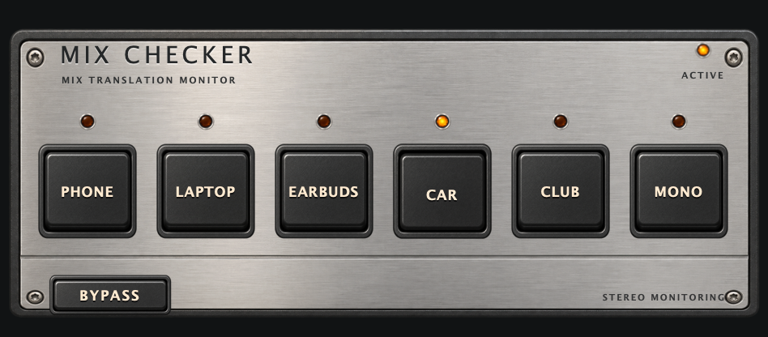

# Mix Checker

Mix Checker is a compact macOS audio effect for checking how a stereo mix translates to common playback environments. Insert it near the end of a monitoring or master-bus chain, switch environments, and return to a transparent Bypass with one click.

<p align="center">
  
</p>

The profiles are intentionally broad mix-checking references, not physical models of specific phones, cars, speakers, or venues.

## Features

- Seven mutually exclusive states: Phone, Laptop, Earbuds, Car, Club, Mono, and Bypass
- Transparent stereo Bypass after the short mode transition settles
- Fixed per-mode gain compensation for more comfortable comparisons
- 30 ms smoothed switching, including transitions into and out of Mono and Bypass
- DAW project state restoration for the selected mode
- Compact fixed-size `474 x 208` hardware-inspired interface
- Stereo Audio Unit and VST3 effect targets
- No meters, user parameters, preset browser, accounts, or background services

Clicking the currently selected playback mode a second time returns the plugin to Bypass. The processor remains the source of truth, so DSP, indicator lights, editor reopening, and restored DAW state stay synchronized.

## Playback Modes

| Mode | Translation focus |
| --- | --- |
| Phone | Strong low- and high-frequency restriction, forward mids, narrow image |
| Laptop | Reduced low end, lighter bandwidth restriction, moderately narrow image |
| Earbuds | Extended bandwidth with modest low-frequency emphasis and slight widening |
| Car | Low/low-mid emphasis, reduced extreme highs, wider image |
| Club | Bass-focused playback with a broad, slightly widened presentation |
| Mono | Equal left and right output using a centred mono sum |
| Bypass | Transparent unity-gain stereo path |

Each processed mode uses the same reusable chain:

```text
High-pass -> Parametric EQ -> Low-pass -> Stereo width -> Output gain
```

## Formats and Compatibility

| Format | Current validation |
| --- | --- |
| Audio Unit (AUv2) | Release build, strict `auval`, and Logic Pro 11.2.2 loading/playback verified |
| VST3 | Release build, bundle metadata and signature verified; Cubase Pro 15 scanner reports `Mix Checker OK` |

Current development validation is on macOS 15.8.1, Apple Silicon (`arm64`). Intel and Universal builds have not been tested.

Logic Pro uses the Audio Unit build. Use the VST3 build in a VST3-compatible host. The current VST3 verification covers successful Cubase scanning; full insert, editor, and playback testing in a VST3 host is still pending.

## Requirements

- macOS
- CMake 3.22 or newer
- Xcode Command Line Tools or Xcode
- Git and an internet connection when JUCE is not already installed

The project uses JUCE 9.0.3. CMake first looks for an installed JUCE package and otherwise fetches that tagged version automatically.

## Build from Source

```bash
git clone https://github.com/yiyangbear/MixChecker.git
cd MixChecker

cmake -S . -B build \
  -DCMAKE_BUILD_TYPE=Release \
  -DCMAKE_OSX_DEPLOYMENT_TARGET=11.0 \
  -DBUILD_TESTING=ON

cmake --build build \
  --config Release \
  --target MixChecker_AU MixChecker_VST3 MixCheckerPassThroughTest \
  --parallel 8
```

Build products:

```text
build/MixChecker_artefacts/Release/AU/Mix Checker.component
build/MixChecker_artefacts/Release/VST3/Mix Checker.vst3
```

Both macOS bundles receive an ad-hoc signature during the local build. They are not Developer ID signed or notarized distribution packages.

## Install Locally

Install either or both formats for the current user:

```bash
mkdir -p "$HOME/Library/Audio/Plug-Ins/Components"
mkdir -p "$HOME/Library/Audio/Plug-Ins/VST3"

ditto \
  "build/MixChecker_artefacts/Release/AU/Mix Checker.component" \
  "$HOME/Library/Audio/Plug-Ins/Components/Mix Checker.component"

ditto \
  "build/MixChecker_artefacts/Release/VST3/Mix Checker.vst3" \
  "$HOME/Library/Audio/Plug-Ins/VST3/Mix Checker.vst3"
```

Restart the target DAW after installation. For AU development, refreshing the macOS registrar may also help:

```bash
killall AudioComponentRegistrar 2>/dev/null || true
```

## Test and Validate

Run the automated regression suite:

```bash
ctest --test-dir build --output-on-failure
```

After installing the AU, run Apple's strict validator:

```bash
auval -v aufx MxCh MxCk -strict
```

The regression suite covers stereo pass-through, every DSP profile, Mono behavior, gain compensation, smoothed mode changes, rapid switching, state serialization, editor synchronization, and repeated-click-to-Bypass behavior.

## Implementation Notes

- The processor owns the active mode; the editor only requests changes and reflects processor state.
- Mode changes use preallocated DSP chains. The audio callback performs no file I/O, logging, mutex locking, or deliberate allocation.
- The selected mode is serialized as a validated lowercase name in a small JUCE `ValueTree`; invalid state falls back to Bypass.
- UI artwork is embedded into the plugin. Runtime loading does not depend on machine-local image paths.
- Mix Checker reports zero intentional latency.

## Known Limitations

- Playback profiles are practical approximations rather than calibrated device models.
- Gain compensation is fixed; there is no LUFS, RMS, or adaptive loudness matching.
- The editor size and 30 ms transition time are fixed.
- There are no user-editable DSP parameters or user presets in v0.1.
- Intel, Universal Binary, installer, Developer ID signing, and notarization workflows are not yet provided.
- Full VST3 insertion, editor, audio, and state-restore testing remains to be completed in a VST3 host.

## Project Status

Version `0.1.0` is feature-complete for the original Mix Checker scope. See [`SPEC.md`](SPEC.md) for the product scope and [`PROGRESS.md`](PROGRESS.md) for the detailed implementation and validation history.

## License

No open-source license has been selected yet. Until a `LICENSE` file is added, the source code and bundled UI artwork remain all rights reserved.
